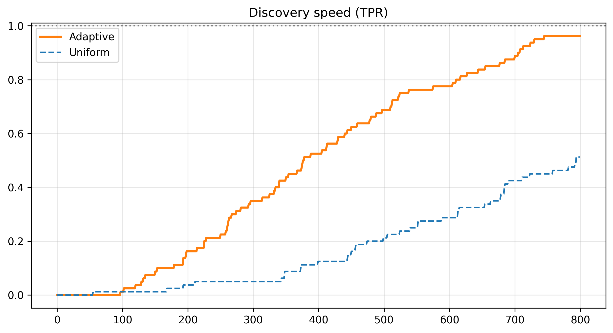

How can we identify useful interventions while spending fewer observations on uninformative ones? This team project studies **adaptive sampling for sequential multiple testing**, combining multi-armed bandits with the statistical problem of false discovery control.

**With:** Ines Bahraoui and Chams-Eddine Bouaziz. **Supervision:** Adrien Nguyen-Huu and Luka Boisgibault, University of Montpellier, 2025–2026.

## Question and approach

We study the framework of Jamieson and Jain: repeatedly sample one of $n$ arms, compare its unknown mean $\mu_i$ with a reference $\mu_0$, and maintain a set of discoveries $S_t$. The purpose is to identify arms above the reference, rather than maximize cumulative reward.

Writing $H_0 = \{i : \mu_i \leq \mu_0\}$ and $H_1 = \{i : \mu_i > \mu_0\}$, two complementary quantities are:

$$
\operatorname{FDR}(t) = \mathbb{E}\!\left[\frac{|S_t \cap H_0|}{|S_t|\vee 1}\right],
\qquad
\operatorname{TPR}(t) = \mathbb{E}\!\left[\frac{|S_t \cap H_1|}{|H_1|}\right].
$$

The TPR is considered when $H_1$ is nonempty. The challenge is to discover positives quickly while keeping false discoveries under control. Repeatedly checking ordinary fixed-time tests is insufficient when sampling and stopping decisions depend on past observations.

## Sequential inference and allocation

The study combines three components:

1. **Sampling:** an adaptive UCB-style rule, or uniform allocation as a baseline.
2. **Inference:** confidence sequences and anytime p-values that account for repeated observation.
3. **Multiple testing:** a Benjamini–Hochberg-style discovery procedure.

A confidence sequence aims at a simultaneous coverage statement of the form

$$
\mathbb{P}\!\left(\forall s\geq 1,\; |\widehat\mu_{i,s}-\mu_i|\leq \phi_i(s,\alpha)\right)\geq 1-\alpha.
$$

Such a statement requires assumptions appropriate to the observations and the chosen boundary. It cannot be inferred from a simulation alone.

The implementation compares several constructions:

| Variant | Main component |
|---|---|
| JJ | LIL-based confidence boundary and numerical inversion |
| V2 | Normal-mixture construction and closed-form p-value calculation |
| V3 | Betting-based construction, with binary and continuous variants |
| SR | Successive-rejection allocation used as a comparison |

The repository also includes a Streamlit interface for exploring individual simulations and comparing configurations.

## Empirical study

The report investigates the effect of the confidence level, noise, distance to the reference, initialization budget and proportion of positive arms. It compares detection trajectories, false discoveries and discovery orders on synthetic data and on resampled megastudy datasets.

*Illustration from the project’s simulations. Full protocols and results are available in the report.*

In the experiments reported, adaptive allocation generally reaches comparable discovery sets earlier than uniform allocation. The advantage varies with signal strength, noise, initialization and the number of positive arms; it is not a universal fixed reduction in sample size.

## Interpretation and limitations

The report distinguishes **empirical performance** from **formal statistical guarantees**. In particular, estimating the reference from an evolving control arm changes the original fixed-reference setting. Plugging an empirical variance into a confidence boundary also requires justification.

On real datasets, the truly positive arms are unknown. Resampling supports comparisons between algorithms on the available data, but does not establish a causal ground truth. These limitations are part of the study and motivate further work on suitable sequential inference constructions.

## Reference

Kevin Jamieson and Lalit Jain (2018; arXiv revision 2019), [*A Bandit Approach to Multiple Testing with False Discovery Control*](https://arxiv.org/abs/1809.02235). The project report provides the full bibliography and experimental details.
